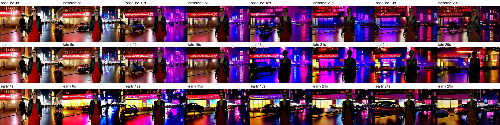

# Cross-attention 残差幅值缩放：实验设置与初步负结果

## 研究目的
研究假设2：Text conditioning may exert an overly strong relative influence in some long-rollout states.

检验在限定时间窗口内减弱或增强 cross-attention 对残差流的写入，是否能够改善长视频生成中的重复或人物连续性问题。同时观察原生生成中 CA 的相对写入幅度是否在后期普遍增强。 

假设：如果较强或者较弱的文本条件写入妨碍了事件推进，那么适度降低或者增强 CA 输出可能带来收益。

## 干预公式与位置

令 H 为完成当前层 SA 更新、即将进入 CA 的视频特征，C 为文本条件。原生计算为：

$$
R_{\mathrm{CA}}=\mathrm{CA}(\mathrm{norm3}(H),C),\qquad
T=H+R_{\mathrm{CA}}.
$$

干预改为：

$$
H'=H+\gamma R_{\mathrm{CA}},\qquad \gamma\in\{0.8,1.0,1.2\}.
$$

## 实验设置与对照

- 模型：Self-Forcing DMD checkpoint
- 样本：prompt 0、seed 0；(video prompt)
- 视频：每条 30 秒、16 FPS、832×480；
- 缓存窗口：21 个 latent 帧。
- 作用层：全部 30 层；作用去噪步：全部 4 步
- clean-context KV refill 不直接缩放，乘数保持为 1。

## 观察结果
### Cross-Attn 的相对写入幅度

| 去噪步 | 晚期／早期比值的跨层中位数 | 比值大于 1 的层数 |
| --- | ------------- | ---------- |
| 0   | 0.999         | 15/30      |
| 1   | 0.980         | 13/30      |
| 2   | 0.970         | 10/30      |
| 3   | 0.960         | 9/30       |
没有观察到 CA 相对写入幅度在后期普遍增强 

### 视频目视结果
原生、晚期缩放、早期缩放 结果是效果都不好，

$$0.8$$ 实验的逐秒抽帧比较显示，缩放确实改变了生成结果：

- 晚期缩放后，约 18–21 秒的人物更暗、接近剪影，背景霓虹色和照明也发生变化。
- 早期对照在约 6–10 秒即出现色彩、亮度和背景差异，且差异在窗口结束后继续存在。
- 目视比较未观察到明确的视频连续性改善。补充的 $$1.2$$ 测试同样未见明显收益。

基本效果不明显：无论减弱还是增强，均未观察到明确的生成质量或连续性改善。

可能问题：
1. 不一定是每个layer都要改，但是目前来说去每个layer都去尝试没什么必要 
2.  整体缩放只调整幅值，对给定的 CA 输出，正系数缩放只改变其幅值，不改变其方向及各方向成分的相对比例。如果问题涉及 SA–CA 的方向关系或空间对应，单一缩放系数可能缺乏针对性。
