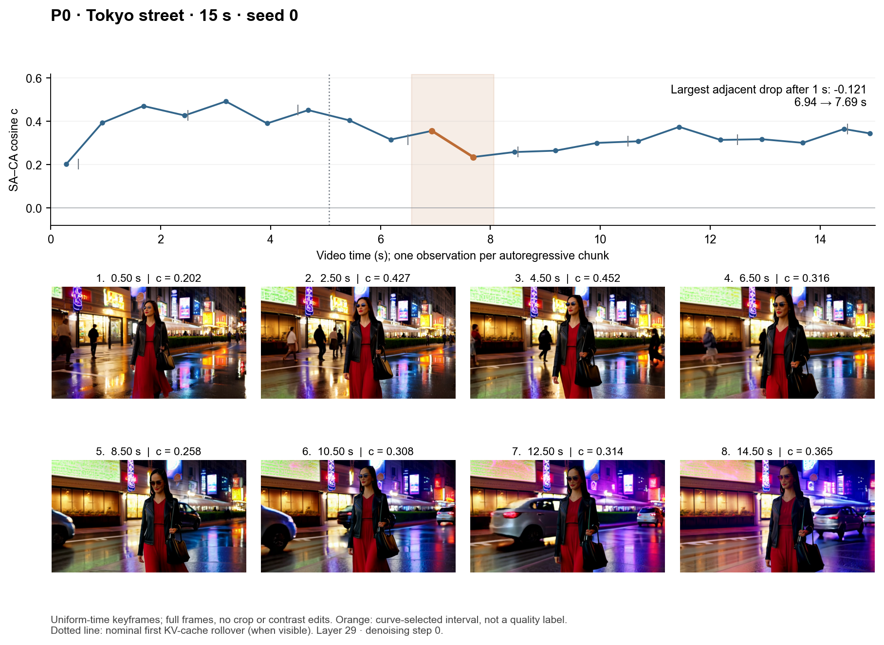
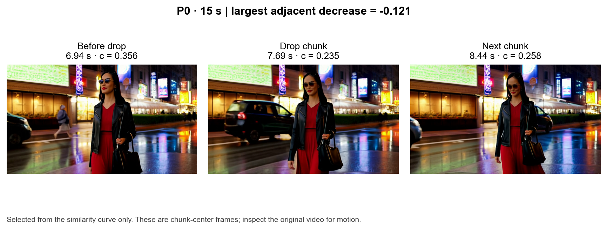
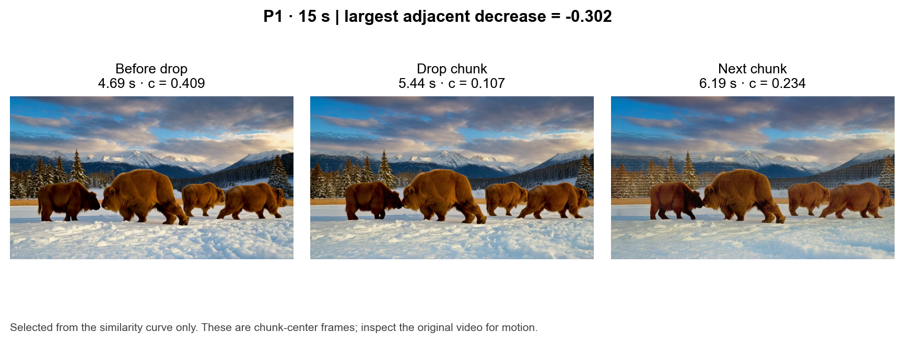
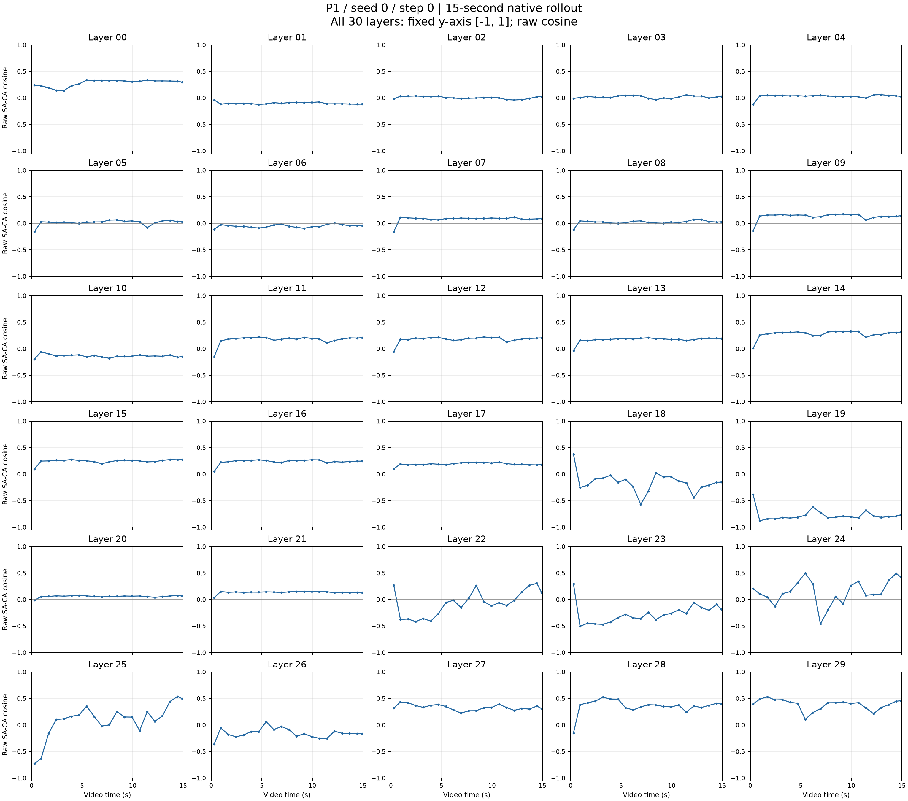
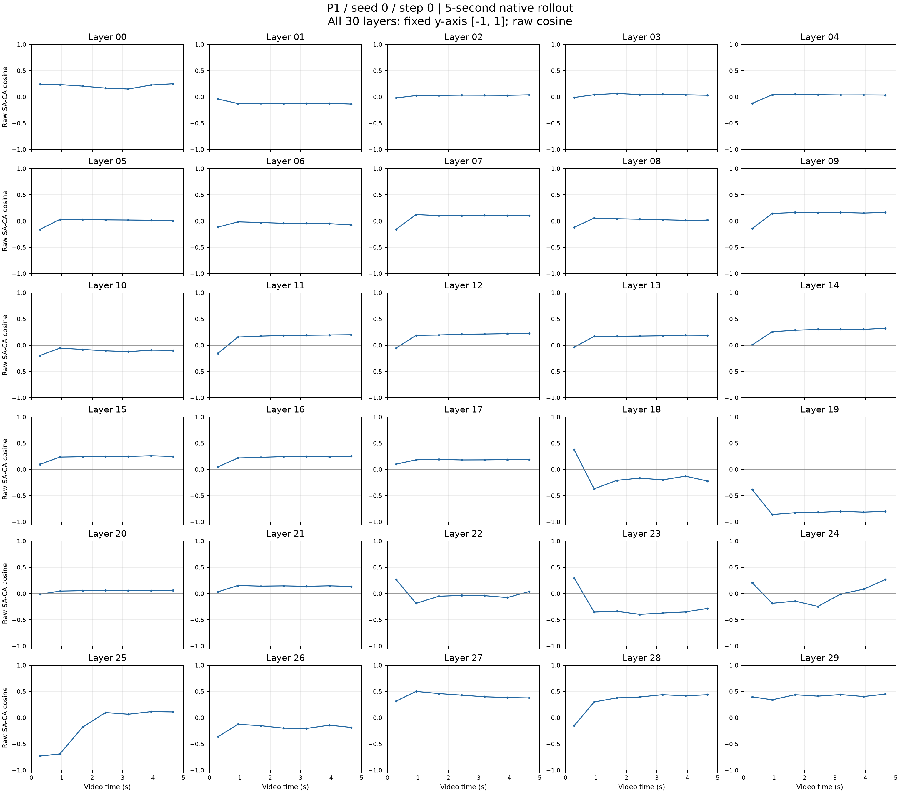

# SA–CA Write Alignment over Time

想法是先用简单的方法去研究cross-attn和self-attn的关系，看看是否在视频退化的时候存在一些通用的规律 帮助我们去理解两者之间的关系  

**假设**：在视频退化，重复之前，cross-attn和self-attn 的写入之间的方向关系可能发生变化。 我们主要研究了cross-attn和self-attn 以两者实际残差写入的余弦相似度

### 详细实验过程
为了方便研究，我们只选取最后一个layer和第一个去噪步，因为最后一个layer结果会受到前面影响，选取第一个去噪步原因是wan视频生成模型被蒸馏，第一步去噪变化最大。

生成一条原生 5，10，15，30 秒视频，固定：
- 第一个去噪步：step 0。
- 最后一层：layer 29。
- 每个自回归 chunk 统计一次，不进行干预。

设 $$U_t$$ 为当前 block 输入，记录两个实际写入：

$$
S_t=g_{\mathrm{SA}}\odot \mathrm{SA}(\widetilde U_t;\mathrm{KV}), \qquad R_t=\mathrm{CA}\bigl(\mathrm{norm3}(U_t+S_t),C\bigr).
$$

其中 $$S_t$$ 包含 SA 输出投影与原生 gate，$$R_t$$ 包含 CA 输出投影；$$t$$ 表示视频 chunk 

计算整个 chunk 的余弦相似度：

$$
\boxed{ c_t= \frac{\langle S_t,R_t\rangle_F} {\|S_t\|_F\|R_t\|_F} }
$$

绘制 $$c_t$$ 随视频时间变化的曲线

### 实验结果：

我们发现在视频变差之前或者同时，相似度会忽然下降。 并且下降后忽然会上升，一个合理的假设是模型是有调节错误的能力的，类似于llm self-recover一样，但是问题是这个错误被写入进去了会影响后续，后续的调节可能是正确的但是会受到错误影响

下一步：构建一个比较好的noise 看看是否可以减小重复， 

## 可视化证据补充

### 失败案例：

#### P0 · 东京街头行走 · 15 秒 

设置：sink:1
余弦相似度下降后画面漂移，动作重复；

<video controls preload="metadata" playsinline src="../assets/cross-attn/Q6_visual_evidence_20261108-p0_s0_15s-time_aligned-1e44b89f63.mp4">Your browser does not support this video. <a href="../assets/cross-attn/Q6_visual_evidence_20261108-p0_s0_15s-time_aligned-1e44b89f63.mp4">Download the video</a>.</video>

展开最大下降附近的三帧对照

#### P1 · 雪地猛犸象 · 15 秒

设置：sink:0 
相似度下降幅度下降后，画面出现闪烁；

<video controls preload="metadata" playsinline src="../assets/cross-attn/Q6_visual_evidence_20261108-p1_s0_15s-time_aligned-a6fd72a4be.mp4">Your browser does not support this video. <a href="../assets/cross-attn/Q6_visual_evidence_20261108-p1_s0_15s-time_aligned-a6fd72a4be.mp4">Download the video</a>.</video>

展开最大下降附近的三帧对照

#### P0 · 东京街头行走 · 30 秒

设置：sink:1
余弦相似度下降时，画面突变；

<video controls preload="metadata" playsinline src="../assets/cross-attn/Q6_visual_evidence_20261108-p0_s0_30s-time_aligned-6f611525fb.mp4">Your browser does not support this video. <a href="../assets/cross-attn/Q6_visual_evidence_20261108-p0_s0_30s-time_aligned-6f611525fb.mp4">Download the video</a>.</video>

### 成功案例：
#### P4 · 小怪物与蜡烛 · 15 秒

设置：sink:0
余弦相似度比较稳定：

<video controls preload="metadata" playsinline src="../assets/cross-attn/Q6_visual_evidence_20261108-p4_s0_15s-time_aligned-77c378c33e.mp4">Your browser does not support this video. <a href="../assets/cross-attn/Q6_visual_evidence_20261108-p4_s0_15s-time_aligned-77c378c33e.mp4">Download the video</a>.</video>

#### P0 · 东京街头行走 · 5 秒
余弦相似度稳定：

设置：sink:1
<video controls preload="metadata" playsinline src="../assets/cross-attn/Q6_visual_evidence_20261108-p0_s0_5s-time_aligned-3da6868466.mp4">Your browser does not support this video. <a href="../assets/cross-attn/Q6_visual_evidence_20261108-p0_s0_5s-time_aligned-3da6868466.mp4">Download the video</a>.</video>

#### P0 · 东京街头行走 · 10 秒

设置：sink:1
余弦相似度稳定：

<video controls preload="metadata" playsinline src="../assets/cross-attn/Q6_visual_evidence_20261108-p0_s0_10s-time_aligned-95ac4722cf.mp4">Your browser does not support this video. <a href="../assets/cross-attn/Q6_visual_evidence_20261108-p0_s0_10s-time_aligned-95ac4722cf.mp4">Download the video</a>.</video>

### 拓展实验:
 对于所有layer都进行分析，生成为 prompt1，15s，seed0 （失败case）
 最开始都有一个突变。（这个可能是个问题）

生成为 prompt1，5s，seed0 （成功案例）

