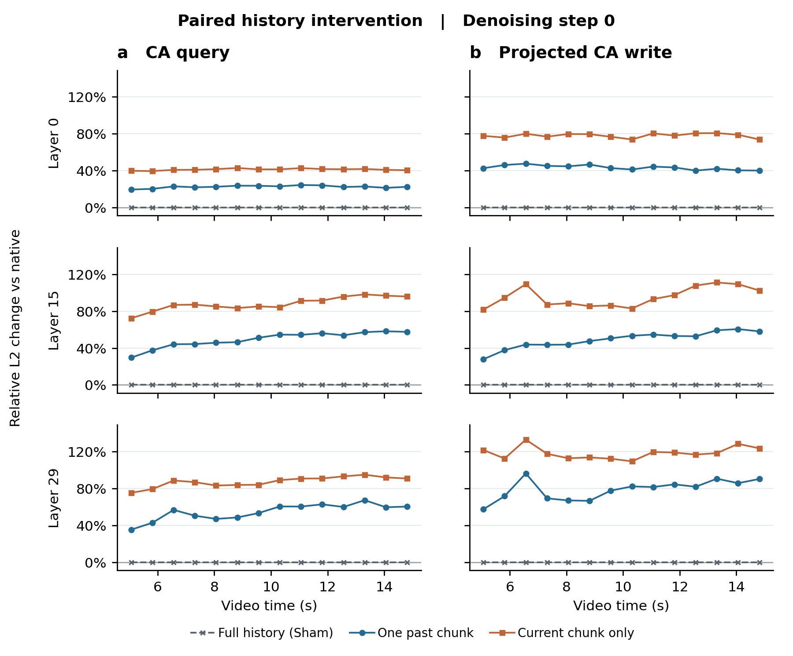
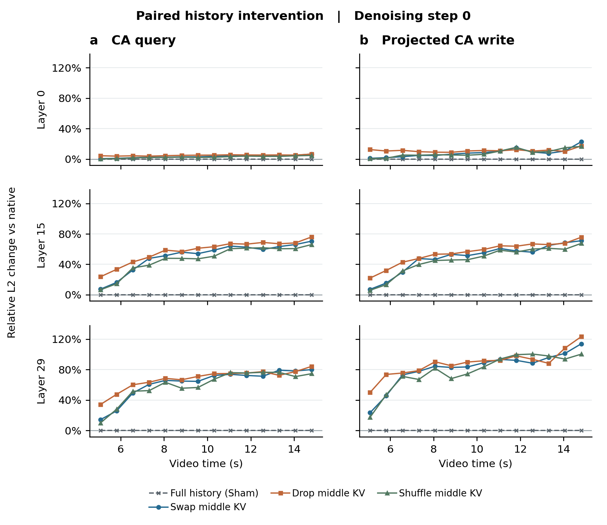

# Middle-History KV and Frozen CA Queries

**假设：**

即使 self-attn 中保留了历史信息，这些信息也未必能被 cross-attn 充分利用  

下表是 P0 三组时间轴实验的设置。

| 项目     | 设置                                       |     |
| ------ | ---------------------------------------- | --- |
| 模型     | Self-Forcing DMD，EMA 权重                  |     |
| 视频     | 15 秒，16 FPS，832×480                      |     |
| 自回归块   | 每个 chunk 为 3 个 latent 帧                  |     |
| 完整缓存窗口 | 21 个 latent 帧，包含当前块                      |     |
| 干预起点   | 从生成 chunk 7开始                            |     |
| 作用层    | 全部 30 层                                  |     |
| 作用阶段   | 启用后的全部 4 个去噪步 及 clean-context refill     |     |
| 配对方式   | 各分支从同一次原生生成的分叉前状态重放，使用相同的初始噪声和重加噪 |     |
|        |                                          |     |
|        |                                          |     |

## CA query 支路的历史读取

**先做单帧历史配对，再做整块历史配对。** 两次实验用同一个公式描述构造 CA query 时的历史读取范围。

固定一条生成轨迹的当前层。$$U$$ 是层输入，$$\widetilde U$$ 是归一化和调制后的 SA 输入。SA 读取范围 $$r$$ 时，产生包含输出投影和原生 gate 的写入 $$S_r$$。

$$
S_r=g\odot\mathrm{SA}(\widetilde U;\mathrm{KV}_r),
\qquad
T_r=U+S_F
+\mathrm{CA}\!\left(\mathrm{norm3}\!\left(U+S_r\right),C\right).
$$

直观上，$$U+S_r$$ 决定 CA **用什么特征去读文本**，$$U+S_F$$ 决定 **把读到的结果加回哪里**。$$C$$ 是原 prompt 的文本条件，$$T_r$$ 是加完 CA 写入后、进入 FFN 前的残差。(正常来说$$S_r=S_f$$ ) 

| 顺序  | 条件                     | 构造 CA query 时 SA 读取的范围       |
| --- | ---------------------- | ---------------------------- |
| 1   | 最近一帧历史（$$r=1\mathrm f$$） | 最近 **1 个历史 latent 帧＋当前 3 帧** |
| 1,2 | 完整历史重放（$$r=F$$，Sham）     | 完整可见窗口，包含当前块                 |
| 2   | 最近一个历史 chunk（$$r=1$$）    | 最近 **3 个历史 latent 帧＋当前 3 帧** |
| 2   | 仅当前 chunk（$$r=0$$）       | 当前块的 **3 个 latent 帧**        |

每次配对从该次原生生成的同一存档分叉。公式中的 $$U$$ 和 $$Z_F$$ 由各分支按相同规则、用各自的生成状态计算。

$$
S_{\mathrm{frame},j}=g_j\odot\mathrm{SA}\!\left(\widetilde U_j;\mathrm{KV}_{\mathrm{frame},j}\right),\qquad
T_j=Z_{F,j}+\mathrm{CA}\bigl(\mathrm{norm3}(U_j+S_{\mathrm{frame},j}),C\bigr).
$$

### 1. 缩短 CA query 支路的历史

**第一步 · 保留最近 1 个历史 latent 帧（P0 和 P4）**

CA query 支路读取 **1 个历史 latent 帧＋当前 3 帧**，在各后续 chunk 的四个去噪步启用，回填使用原生 query。

<video controls preload="metadata" playsinline src="../assets/cross-attn/Q7_middle_and_frozen_ca_20261114-p0_ca_keep1_frame_comparison-c597c4e5a1.mp4">Your browser does not support this video. <a href="../assets/cross-attn/Q7_middle_and_frozen_ca_20261114-p0_ca_keep1_frame_comparison-c597c4e5a1.mp4">Download the video</a>.</video>

**P4 · （成功对照）**

<video controls preload="metadata" playsinline src="../assets/cross-attn/Q7_middle_and_frozen_ca_20261114-p4_ca_keep1_frame_comparison-67ba1ad226.mp4">Your browser does not support this video. <a href="../assets/cross-attn/Q7_middle_and_frozen_ca_20261114-p4_ca_keep1_frame_comparison-67ba1ad226.mp4">Download the video</a>.</video>

#### 生成结果
生成有闪烁，但是不影响事件发展 ，可能的原因是生成chunk是三帧，这里只保留一帧，所以出现了闪烁，所以下个实验 我们还是放在保留chunk间去研究。 

### 2. 实证cross-attn query和 残差的大小 

按历史 chunk 比较。
三条视频均为 P0、seed 0、EMA、15 秒、16 FPS，主 SA 使用 21 个 latent 帧的滚动窗口。两组干预从 chunk 7 起，在全部 30 层的四个去噪步和干净上下文回填时启用。原生与 Sham 的 MP4 逐字节一致，下面用原生视频代表完整历史组。
#### **实验目的**：
中间帧是包含历史信息的，如果在cross-attn中删除这些历史信息按道理会发生很大变化对于视频来说，如果视频变化不大，说明可能无法从视觉中显示出来。  

**完整历史 · 原生视频**

<video controls preload="metadata" playsinline src="../assets/cross-attn/Q08_ca_query_timeline-p0_native-1b380bb5a4.mp4">Your browser does not support this video. <a href="../assets/cross-attn/Q08_ca_query_timeline-p0_native-1b380bb5a4.mp4">Download the video</a>.</video>

**CA query · 最近一个历史 chunk＋当前 chunk**

<video controls preload="metadata" playsinline src="../assets/cross-attn/Q08_ca_query_timeline-p0_ca_keep1_chunk-56d8514637.mp4">Your browser does not support this video. <a href="../assets/cross-attn/Q08_ca_query_timeline-p0_ca_keep1_chunk-56d8514637.mp4">Download the video</a>.</video>

**CA query · 仅当前 chunk**

<video controls preload="metadata" playsinline src="../assets/cross-attn/Q08_ca_query_timeline-p0_ca_keep0_chunk-44ff814f0b.mp4">Your browser does not support this video. <a href="../assets/cross-attn/Q08_ca_query_timeline-p0_ca_keep0_chunk-44ff814f0b.mp4">Download the video</a>.</video>

**CA query 的相对 $$L_2$$ 变化**

$$
\Delta_Q(t,\ell)= \frac{\left\|Q^{\mathrm{实验组}}_{t,\ell}-Q^{\mathrm{原生}}_{t,\ell}\right\|_2} {\left\|Q^{\mathrm{原生}}_{t,\ell}\right\|_2} \times 100\%.
$$

**右图 · 投影后 CA 残差写入的相对 $$L_2$$ 变化**

$$
\Delta_R(t,\ell)= \frac{\left\|R^{\mathrm{实验组}}_{t,\ell}-R^{\mathrm{原生}}_{t,\ell}\right\|_2} {\left\|R^{\mathrm{原生}}_{t,\ell}\right\|_2} \times 100\%.
$$

#### 结果：
生成结果大体类似于完整历史结果，但是画面闪烁（只保留一个frame），可能的原因是生成chunk是三帧，这里只保留一帧，所以出现了闪烁 

对于实验2，很明显query和残差的 L2距离 存在变化 ，但是视频感觉上并没有什么很大变化。

可能的假设：
1. cross-attn对于事件进展不重要，这个合理，整体的text kv是不变的，唯一变的是q（被视觉特征+self-attn 驱动的）
2. self-attn 存在有用的事件信号，但是无法通过cross-attn 在视频显现出来，比如 实验2，内部的l2距离变化比较明显，不过视频特征变化比较小。
3. 可能改进方向：针对于 cross-attn ：query（受sa调制的U影响），text kv cache 

## 直接改主 SA 的中段历史

直接修改self-attn的kv cache记录 

中段swap 直接修改真实 SA KV cache
中段删除则改变主 SA 的读取范围。两种干预都先改变主 SA 的写入，CA 沿用原生顺序，从更新后的残差流构造 query。

| 组别          | 实际操作                                                                     |
| ----------- | ------------------------------------------------------------------------ |
| 原生视频        | 从原始噪声连续生成 15 秒，作为同组参考。                                                   |
| 无干预重放（Sham） | 恢复 5.0625 秒的缓存、随机状态和后续噪声，继续生成。                                           |
| 中段换位        | 每个 chunk 第一次去噪前，在真实 SA KV cache 中交换可见历史正中间的两个 chunk，并按目标位置调整 K 的时间 RoPE。 |
| 中段删除        | 在四个去噪步中，从主 SA 读取范围排除中间两个 chunk，共 6 个 latent 帧。其余帧保留原有时间位置。               |

两组对比视频的上排是原生和 Sham 重放，下排是中段换位和删除。各格按同一时间播放。

**P0 · 东京街头**

<video controls preload="metadata" playsinline src="../assets/cross-attn/Q7_middle_and_frozen_ca_20261114-p0_middle_comparison-cc088755c7.mp4">Your browser does not support this video. <a href="../assets/cross-attn/Q7_middle_and_frozen_ca_20261114-p0_middle_comparison-cc088755c7.mp4">Download the video</a>.</video>

**CA query 的相对 $$L_2$$ 变化**

$$
\Delta_Q(t,\ell)= \frac{\left\|Q^{\mathrm{实验组}}_{t,\ell}-Q^{\mathrm{原生}}_{t,\ell}\right\|_2} {\left\|Q^{\mathrm{原生}}_{t,\ell}\right\|_2} \times 100\%.
$$

**右图 · 投影后 CA 残差写入的相对 $$L_2$$ 变化**

$$
\Delta_R(t,\ell)= \frac{\left\|R^{\mathrm{实验组}}_{t,\ell}-R^{\mathrm{原生}}_{t,\ell}\right\|_2} {\left\|R^{\mathrm{原生}}_{t,\ell}\right\|_2} \times 100\%.
$$

从时间轴看，扰动主 SA 的中段 KV 后，第 15、29 层的 CA query 和投影后写入相对于原生的L2 距离整体上升。目视比较中，删除部分中段 KV 后，背景漂移更明显。相比之下，当只把 CA query 支路的历史缩短到最近一个 chunk、主 SA 仍读取完整历史时，未观察到同等程度的漂移。这提示，**主 SA 读取的历史可能有助于维持背景的时序连续性**。（这里也可以解释很多只修改kv cache的存储的论文（deepforcing）为什么可以去维持不漂移的 ） 

**P4 · 小怪物与蜡烛（成功对照）**

沿用 Q06 里记录的小怪物成功案例。这里使用本次配对实验生成的原片，方便直接核对重放和干预后，小怪物与火焰的动作和外观如何变化。

<video controls preload="metadata" playsinline src="../assets/cross-attn/Q7_middle_and_frozen_ca_20261114-p4_middle_comparison-c3d4f24aa3.mp4">Your browser does not support this video. <a href="../assets/cross-attn/Q7_middle_and_frozen_ca_20261114-p4_middle_comparison-c3d4f24aa3.mp4">Download the video</a>.</video>
 
#### 结果分析
这组实验测到的是**对中段 KV 扰动的敏感性**。

在这两个自然视频里，部分中段历史受扰动后，主体动作还能接上。所以最近历史可能已经包含足够的续接信息。 其他论文验证：

目视比较中，中段换位后，画面和主体动作与原片大体接近。中段删除组出现了更明显的明暗波动，女子行走和小怪物观察蜡烛的动作仍大体延续。

一种可能是，跳过中段self-attn KV 会减少用于维持外观和背景的视觉线索。
（deepforcing等论文可以印证这个问题，他的解决方法是sink 前面很多帧 以保留视觉信息） 

### 固定哪一块 CA query，会改变后续动态
#### 实验目的：
判断是否满足假设：cross-attn对于事件进展不重要

#### 实验方法：
在 P0 上固定 prompt、seed、缓存窗口和干预起点。
保存一个源 chunk 在各层、各去噪步及 KV 回填时实际用到的归一化 CA query。
从 第7个chunk起，每个生成块复用源 chunk 同层、同步的 query。
主 SA 在各分支上继续读写滚动缓存，而cross-attn的query不更新 。

| 5.0625 秒后的设置          | 画面表现                    |
| --------------------- | ----------------------- |
| 原生 CA                 | 女子继续走，后段可见灯光和画面漂移。      |
| 复用满窗时的 query（chunk 6） | 漂移减弱，画面更稳，女子的动作接近静止。    |
| 复用首块 query（chunk 0）   | 女子仍持续行走，但反复出现雾状亮斑和明暗闪烁。 |

左到右为原生、满窗 query 冻结、首块 query 冻结。两个冻结组都在 5.0625 秒启动。

<video controls preload="metadata" playsinline src="../assets/cross-attn/Q7_middle_and_frozen_ca_20261114-p0_ca_frozen_comparison-2f47a8214e.mp4">Your browser does not support this video. <a href="../assets/cross-attn/Q7_middle_and_frozen_ca_20261114-p0_ca_frozen_comparison-2f47a8214e.mp4">Download the video</a>.</video>

##### 结果
cross-attn既可以影响画面是否漂移也可以影响重复问题，那么就推翻了假设：cross-attn对于事件进展不重要 

两个cross-attn的q都不变，一个是基本静止但是画面也不怎么漂移（7个chunk），另一个是画面闪烁但是人物动作不重复。（一个chunk） 

这里有一些问题：我们之前有说明self-attn 对于维持视觉信息更加重要，不过这里固定复用满窗时的 query  却可以使得 画面也不怎么漂移 这个是为什么呢？  所以可能的原因是存在描述性词语可以控制画面，那为什么冻结首个chunk时候的query 可以跳出重复呢？

##### 待验证假设：
可能原因是 复用满窗时的 query 更加关注 描述词语？ 而冻结首个chunk时候的query 更加关注动作词？ 

## 可能的idea：
结论：给cross-attn少看一些历史kv cache结果影响不大，给self-attn 少看部分历史kv cache 只影响背景漂移，对于事件进展和理解中间历史语义信息来说基本都没什么影响。历史的语义或者什么信息这里可能是已经被忽略了 

把中段视频历史kv cache压缩成少量事件记忆 token 放在 cross-attn，用于记载事情推进，核心想法是首先中间kv cache是肯定存了一堆类似的视觉特征，这种可以类似于deepforcing论文就sink 几帧即可，而中间的历史信息目前来说是肯定忽略了，用语义去记载 感觉上来说是效果要更好的 

- 为什么放在cross-attn 为什么比放在self-attn好（符合人类记忆模式，把一些大概的发生过的东西写出来，同时self-attn可能还是可以保留的一部分去作为一个细节检索呢？） 怎么证明呢？
- 视觉特征怎么变成语义特征？改 prompt 效果小，这条路凭什么有效？ 
- 提取出的历史语义，如何随视频生成持续更新，并通过 Cross-Attention 与当前画面和原 prompt 结合，指导下一块的生成？具体怎么实现呢 ，有什么阻碍呢？
