# Self-Forcing inference 过程详解

## 主要流程

当前块带噪 latent + 当前去噪 timestep

→ Patch Embedding：latent 转成视频 tokens

→ Timestep Embedding：生成噪声水平的调制向量

→ 进入 Transformer（依次经过 30 层）

→ LayerNorm + Timestep 调制

→ 计算当前块 Q、K、V

→ Q、K 归一化

→ 对 Q、K 应用时空 RoPE

→ 将当前块 K、V 写入/覆盖该层 KV cache

→ Self-Attention：当前 Q 关注历史块和当前块的 K、V

→ 输出投影 + 残差连接

→ Cross-Attention：视频 Q 关注文本 K、V

→ 残差连接

→ LayerNorm + Timestep 调制

→ FFN + 残差连接

→ 下一层

→ 输出 Head + Unpatchify

→ 得到 Flow 预测

→ 根据带噪 latent、噪声比例和 Flow，计算干净 latent 预测

→ 若还有去噪步骤：按下一步噪声水平重新加噪 → 重复上述过程

→ 若是最后一步：保存当前块的干净 latent

→ 将干净 latent 以 timestep=0 再送入模型

→ 刷新当前块在各层的 KV cache，作为后续块的历史条件

→ 开始生成下一块

→ 所有块生成完成

→ 拼成完整 latent 视频

→ VAE 解码

→ RGB 视频

  

## 对于head 动态研究的关注来说

  

先调制：


$$
\widetilde X_t^{(l)} = \operatorname{LN}(X_t^{(l)}) \odot(1+\gamma_t^{(l)}) +\beta_t^{(l)}
$$


针对每个head:
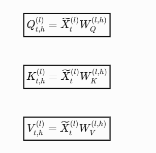

Normalization 后 -> ROPE :

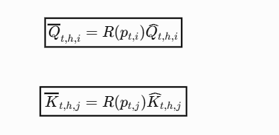
  

KV Cache 拼接：
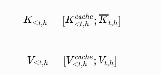

针对每个head 做Self-attn：
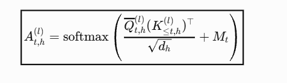

计算Z：

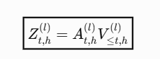
W 拼接

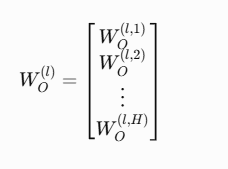
每个head的实际贡献：
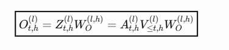

  

求和：
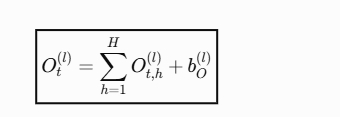

Residual ：
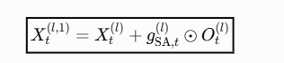

某个 Head 对 residual stream 的贡献

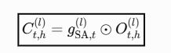

### CrossAttn 对于其影响：

```text
当前带噪视频特征 + 当前层可访问的历史 KV
                    ↓
              Self-Attention
                    ↓
              更新后的视频特征
                    ↓
              生成 Cross-Attention 的 Q
                    ↓
              Q 读取文本 K、V
                    ↓
              更新视频特征
```


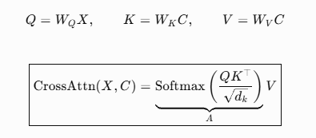
#### crossattn 简单原型：
- $$u_t$$：当前块自身的特征。
- $$h_{t-1}$$：之前生成内容的历史特征。
- $$B$$：由文本和模型参数决定的固定矩阵。

复杂一点的模型：


$$
\boxed{ Y_t=\operatorname{SelfAttn}(\operatorname{AdaLN}(U_t);\mathrm{KV}_{\le t}), \qquad Z_t=U_t+g_t\odot Y_t }
$$


cross-attention 随后读取：


$$
\boxed{ Q_t=\operatorname{RMSNorm}_Q \bigl(\operatorname{Linear}_Q(N_3(Z_t))\bigr), \qquad A_{t,h}=\operatorname{softmax} \left(\frac{Q_{t,h}K_h^\top}{\sqrt{d_h}}\right) }
$$
